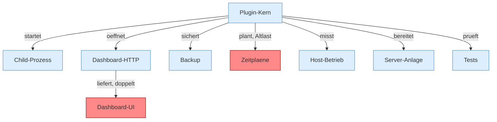

[[00 Start]]

# 00 Start



```knoten
Plugin-Kern
  FabricLauncherPlugin: Lebenszyklus, Befehl /child, Config und der eine Fokus-Slot.
Child-Prozess
  Der eine Child: starten, Ausgabe lesen, neu starten, stoppen. Die Kante Quelltext ist nur die Reihenfolge im Quelltext.
Dashboard-HTTP
  com.sun.net.httpserver, Kontext / zeigt auf Dashboard.handle.
Dashboard-UI
  React-Hülle um das gebündelte web/index.html. Dieselbe Oberfläche existiert zweimal. Befund: doppelte Implementierung (sicher).
Backup
  Lokales Zip über BackupBridge oder FTP/FTPS über RemoteBackupBridge.
Zeitplaene
  Zeitpläne und daneben weiter die alten Tasks, beide alle 20 s. Befund: Altlast (sicher).
Host-Betrieb
  Misst den Host-Speicher, stoppt bei Druck nur den Child, verkleinert den Host und richtet ihn einmal ein.
Server-Anlage
  Versionen, Profile und der Startplan. Profiles.load liest servers.*, der Kern behält einen Server.
Tests
  JUnit unter src/test. Die Methoden sind erreichbar, damit sie nicht als Lücke im Aufrufgraph gelten.
```

- Ein Child-Server, gesteuert vom Plugin `FabricLauncherPlugin` (`plugin.yml`: Befehl `/child`).
- Dashboard: `com.sun.net.httpserver` plus gebündeltes `web/index.html`, von React in `ui/` umgebaut.
- Hover über einen Block: Plugin `Mermaid Knoten Hover` im Vault. Eingeschränkten Modus aus, dann unter Community-Plugins einschalten.
- Commit `95b02b953b0b4c23673e900e021a7c3c844aa37d`.
- [[befunde]] · [[bericht]]
