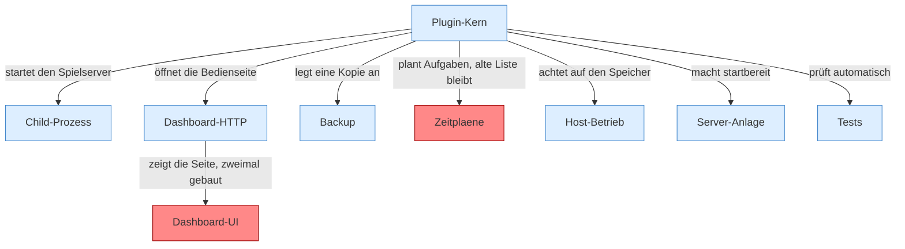

[[00 Start]]

# 00 Start



```knoten
Plugin-Kern
  Das [[Glossar#Plugin|Plugin]] selbst. Es nimmt [[Glossar#Befehl|Befehle]] entgegen, liest die [[Glossar#Einstellungen|Einstellungen]] und steuert den einen [[Glossar#Spielserver|Spielserver]].
Child-Prozess
  Der [[Glossar#Spielserver|Spielserver]] als eigenes Programm: einschalten, Meldungen mitlesen, neu starten, ausschalten. Pfeile mit [[Glossar#Kapitel|Kapitel]] im Text sind keine zeitliche Reihenfolge. Im Zustandsbild heißen die Zustände aus, startet, läuft und stoppt. Im [[Glossar#Quelltext|Quelltext]] heißen sie IDLE, PREPARING, RUNNING und STOPPING.
Dashboard-HTTP
  Die Tür, über die der Browser mit dem [[Glossar#Plugin|Plugin]] spricht. Sie liefert die [[Glossar#Bedienseite|Bedienseite]] aus und nimmt Aufträge an.
Dashboard-UI
  Die [[Glossar#Bedienseite|Bedienseite]], die man im Browser sieht. Dieselbe Seite ist zweimal gebaut, einmal älter und einmal neuer. Das nennt man [[Glossar#Doppelt gebaut|Doppelt gebaut]].
Backup
  Eine [[Glossar#Sicherungskopie|Sicherungskopie]] der [[Glossar#Spielwelt|Spielwelt]], entweder auf diesem Rechner oder über das Netz auf einen anderen.
Zeitplaene
  Zeitpläne und daneben die ältere Aufgabenliste. Beide werden regelmäßig angeschaut. Die alte Liste ist eine [[Glossar#Altlast|Altlast]].
Host-Betrieb
  Das [[Glossar#Plugin|Plugin]] misst den [[Glossar#Arbeitsspeicher|Arbeitsspeicher]] des [[Glossar#Host|Host]], kann den [[Glossar#Spielserver|Spielserver]] bei Druck abschalten, den Host verkleinern und ihn einmal einrichten.
Server-Anlage
  Alles vor dem ersten Start: [[Glossar#Version|Version]], die Beschreibung des Servers und der [[Glossar#Startplan|Startplan]]. Die [[Glossar#Einstellungsdatei|Einstellungsdatei]] kann mehrere Server nennen, benutzt wird der erste.
Tests
  Automatische Probeläufe. Sie gehören nicht zum laufenden Server. Sie sind hier, damit kein [[Glossar#Probelauf|Probelauf]] versehentlich als Lücke gilt.
```

> [!knoten] Was die Blöcke tun
> - **Plugin-Kern**: Das [[Glossar#Plugin|Plugin]] selbst. Es nimmt [[Glossar#Befehl|Befehle]] entgegen, liest die [[Glossar#Einstellungen|Einstellungen]] und steuert den einen [[Glossar#Spielserver|Spielserver]].
> - **Child-Prozess**: Der [[Glossar#Spielserver|Spielserver]] als eigenes Programm: einschalten, Meldungen mitlesen, neu starten, ausschalten. Pfeile mit [[Glossar#Kapitel|Kapitel]] im Text sind keine zeitliche Reihenfolge. Im Zustandsbild heißen die Zustände aus, startet, läuft und stoppt. Im [[Glossar#Quelltext|Quelltext]] heißen sie IDLE, PREPARING, RUNNING und STOPPING.
> - **Dashboard-HTTP**: Die Tür, über die der Browser mit dem [[Glossar#Plugin|Plugin]] spricht. Sie liefert die [[Glossar#Bedienseite|Bedienseite]] aus und nimmt Aufträge an.
> - **Dashboard-UI**: Die [[Glossar#Bedienseite|Bedienseite]], die man im Browser sieht. Dieselbe Seite ist zweimal gebaut, einmal älter und einmal neuer. Das nennt man [[Glossar#Doppelt gebaut|Doppelt gebaut]].
> - **Backup**: Eine [[Glossar#Sicherungskopie|Sicherungskopie]] der [[Glossar#Spielwelt|Spielwelt]], entweder auf diesem Rechner oder über das Netz auf einen anderen.
> - **Zeitplaene**: Zeitpläne und daneben die ältere Aufgabenliste. Beide werden regelmäßig angeschaut. Die alte Liste ist eine [[Glossar#Altlast|Altlast]].
> - **Host-Betrieb**: Das [[Glossar#Plugin|Plugin]] misst den [[Glossar#Arbeitsspeicher|Arbeitsspeicher]] des [[Glossar#Host|Host]], kann den [[Glossar#Spielserver|Spielserver]] bei Druck abschalten, den Host verkleinern und ihn einmal einrichten.
> - **Server-Anlage**: Alles vor dem ersten Start: [[Glossar#Version|Version]], die Beschreibung des Servers und der [[Glossar#Startplan|Startplan]]. Die [[Glossar#Einstellungsdatei|Einstellungsdatei]] kann mehrere Server nennen, benutzt wird der erste.
> - **Tests**: Automatische Probeläufe. Sie gehören nicht zum laufenden Server. Sie sind hier, damit kein [[Glossar#Probelauf|Probelauf]] versehentlich als Lücke gilt.

- Ein Minecraft-Server mit diesem Plugin startet einen zweiten Server und bedient ihn. Unbekannte Wörter stehen im [[Glossar]].
- Die Pfeile sagen, was das Plugin mit dem jeweiligen Teil tut.
- Der Mauszeiger auf einem Block zeigt denselben Satz. Ein Klick öffnet die Seite dazu. Diese Ansicht im Browser: Ordner site, Datei index.html.
- Gelesen aus Commit `95b02b953b0b4c23673e900e021a7c3c844aa37d`.
- [[Glossar]] · [[befunde]] · [[bericht]]
