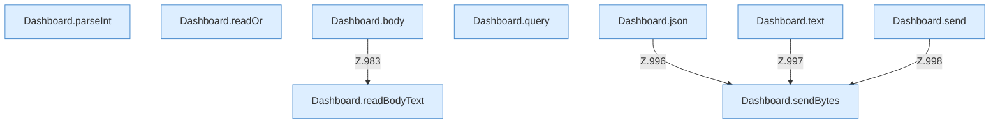

[[00 Start]] › [[Dashboard-HTTP]] › [[API-Antworten]]

# API-Antworten



```knoten
Dashboard.parseInt
  Wertet aus `parseInt`.
Dashboard.readOr
  Liest `readOr`.
Dashboard.readBodyText
  Liest `readBodyText`.
Dashboard.body
  `body` in `Dashboard.java`. Ruft `readBodyText`.
Dashboard.query
  Fragt ab `query`.
Dashboard.json
  Antwortet mit JSON `json`. Ruft `sendBytes`.
Dashboard.text
  Antwortet mit Text `text`. Ruft `sendBytes`.
Dashboard.send
  Sendet `send`. Ruft `sendBytes`.
Dashboard.sendBytes
  Sendet `sendBytes`.
```


