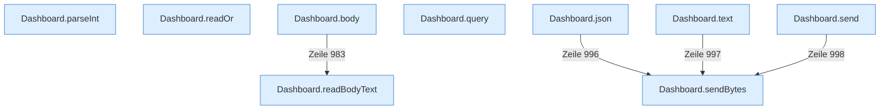

[[00 Start]] › [[Dashboard-HTTP]] › [[API-Antworten]]

# API-Antworten



```knoten
Dashboard.parseInt
  Die [[Glossar#Web-Schnittstelle|Web-Schnittstelle]] liest eine Zahl.
Dashboard.readOr
  Die [[Glossar#Web-Schnittstelle|Web-Schnittstelle]] liest oder den Ersatz.
Dashboard.readBodyText
  Die [[Glossar#Web-Schnittstelle|Web-Schnittstelle]] liest den Text den Text.
Dashboard.body
  Die [[Glossar#Web-Schnittstelle|Web-Schnittstelle]] macht hier einen einzelnen Schritt. Eine Ebene tiefer steht er genauer.
Dashboard.query
  Liest eine Angabe aus der Adresse der Anfrage.
Dashboard.json
  Die [[Glossar#Web-Schnittstelle|Web-Schnittstelle]] macht hier einen einzelnen Schritt. Eine Ebene tiefer steht er genauer.
Dashboard.text
  Die [[Glossar#Web-Schnittstelle|Web-Schnittstelle]] macht hier einen einzelnen Schritt. Eine Ebene tiefer steht er genauer.
Dashboard.send
  Schickt die Antwort an den Browser.
Dashboard.sendBytes
  Die [[Glossar#Web-Schnittstelle|Web-Schnittstelle]] schickt die Größe.
```

> [!knoten] Was die Blöcke tun
> - **Dashboard.parseInt**: Die [[Glossar#Web-Schnittstelle|Web-Schnittstelle]] liest eine Zahl.
> - **Dashboard.readOr**: Die [[Glossar#Web-Schnittstelle|Web-Schnittstelle]] liest oder den Ersatz.
> - **Dashboard.readBodyText**: Die [[Glossar#Web-Schnittstelle|Web-Schnittstelle]] liest den Text den Text.
> - **Dashboard.body**: Die [[Glossar#Web-Schnittstelle|Web-Schnittstelle]] macht hier einen einzelnen Schritt. Eine Ebene tiefer steht er genauer.
> - **Dashboard.query**: Liest eine Angabe aus der Adresse der Anfrage.
> - **Dashboard.json**: Die [[Glossar#Web-Schnittstelle|Web-Schnittstelle]] macht hier einen einzelnen Schritt. Eine Ebene tiefer steht er genauer.
> - **Dashboard.text**: Die [[Glossar#Web-Schnittstelle|Web-Schnittstelle]] macht hier einen einzelnen Schritt. Eine Ebene tiefer steht er genauer.
> - **Dashboard.send**: Schickt die Antwort an den Browser.
> - **Dashboard.sendBytes**: Die [[Glossar#Web-Schnittstelle|Web-Schnittstelle]] schickt die Größe.

- Wie eine Antwort an den Browser aussieht: Text, Zahlen oder eine Fehlermeldung.
