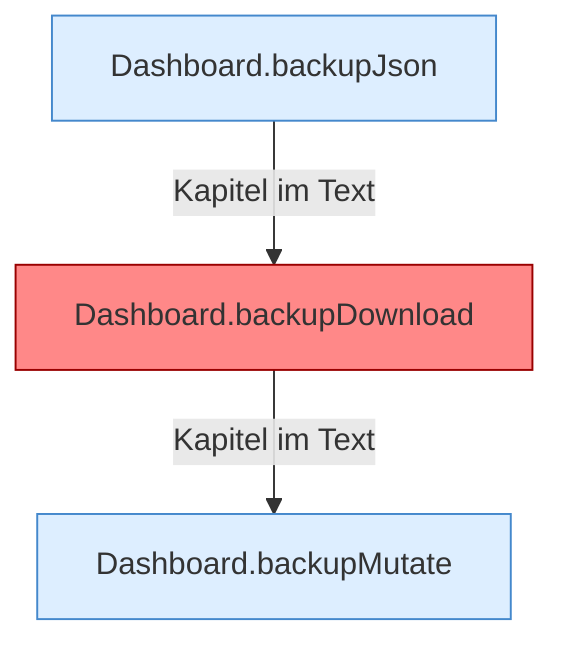

[[00 Start]] › [[Dashboard-HTTP]] › [[API-Backup]]

# API-Backup



```knoten
Dashboard.backupJson
  Die [[Glossar#Web-Schnittstelle|Web-Schnittstelle]] sichert die Antwort.
Dashboard.backupDownload
  Die [[Glossar#Web-Schnittstelle|Web-Schnittstelle]] sichert das Herunterladen. Auffällig: das kann sich anders verhalten, als man erwartet. Das nennt man [[Glossar#Unerwartetes Verhalten|Unerwartetes Verhalten]].
Dashboard.backupMutate
  Ändert eine vorhandene [[Glossar#Sicherungskopie|Sicherungskopie]], zum Beispiel löschen oder zurückholen.
```

> [!knoten] Was die Blöcke tun
> - **Dashboard.backupJson**: Die [[Glossar#Web-Schnittstelle|Web-Schnittstelle]] sichert die Antwort.
> - **Dashboard.backupDownload**: Die [[Glossar#Web-Schnittstelle|Web-Schnittstelle]] sichert das Herunterladen. Auffällig: das kann sich anders verhalten, als man erwartet. Das nennt man [[Glossar#Unerwartetes Verhalten|Unerwartetes Verhalten]].
> - **Dashboard.backupMutate**: Ändert eine vorhandene [[Glossar#Sicherungskopie|Sicherungskopie]], zum Beispiel löschen oder zurückholen.

- Startet eine [[Glossar#Sicherungskopie|Sicherungskopie]], lädt sie herunter, löscht sie oder prüft das Ziel.
