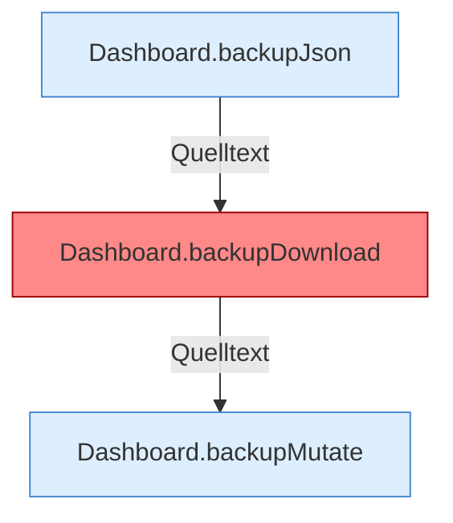

[[00 Start]] › [[Dashboard-HTTP]] › [[API-Backup]]

# API-Backup



```knoten
Dashboard.backupJson
  Sichert `backupJson`.
Dashboard.backupDownload
  Sichert `backupDownload`. Ruft `backupFiles`, `downloadBackup`. Befund: Logikrisiko (sicher).
Dashboard.backupMutate
  Sichert `backupMutate`. Ruft `readBodyText`, `json`, `restoreBackup`.
```


