[[00 Start]] › [[Dashboard-HTTP]] › [[API-Dateien]]

# API-Dateien

```mermaid
flowchart TD
  n1["Dashboard.root"]:::internal-link
  n2["Dashboard.safe"]:::internal-link
  n3["Dashboard.rel"]:::internal-link
  n4["Dashboard.fsList"]:::internal-link
  n5["Dashboard.fsRead"]:::internal-link
  n6["Dashboard.fsDownload"]:::internal-link
  n7["Dashboard.fsWrite"]:::internal-link
  n8["Dashboard.fsUpload"]:::internal-link
  n9["Dashboard.fsRename"]:::internal-link
  n10["Dashboard.fsMkdir"]:::internal-link
  n11["Dashboard.fsDelete"]:::internal-link
  n12["Dashboard.logs"]:::internal-link
  n4 -->|"Zeile 819"| n2
  n4 -->|"Zeile 829"| n3
  n5 -->|"Zeile 833"| n2
  n6 -->|"Zeile 857"| n2
  n7 -->|"Zeile 866"| n2
  n7 -->|"Zeile 870"| n3
  n8 -->|"Zeile 875"| n2
  n8 -->|"Zeile 878"| n3
  n9 -->|"Zeile 893"| n2
  n9 -->|"Zeile 894"| n1
  n9 -->|"Zeile 897"| n3
  n10 -->|"Zeile 902"| n2
  n11 -->|"Zeile 910"| n2
  n11 -->|"Zeile 911"| n1
  n11 -->|"Zeile 914"| n3
  n12 -->|"Zeile 923"| n2
  classDef internal-link fill:#ddeeff,stroke:#4488cc
  classDef befund fill:#f88
```



```knoten
Dashboard.root
  Die [[Glossar#Web-Schnittstelle|Web-Schnittstelle]] macht hier einen einzelnen Schritt. Eine Ebene tiefer steht er genauer.
Dashboard.safe
  Die [[Glossar#Web-Schnittstelle|Web-Schnittstelle]] macht hier einen einzelnen Schritt. Eine Ebene tiefer steht er genauer.
Dashboard.rel
  Die [[Glossar#Web-Schnittstelle|Web-Schnittstelle]] macht hier einen einzelnen Schritt. Eine Ebene tiefer steht er genauer.
Dashboard.fsList
  Die [[Glossar#Web-Schnittstelle|Web-Schnittstelle]] zeigt eine Datei.
Dashboard.fsRead
  Die [[Glossar#Web-Schnittstelle|Web-Schnittstelle]] liest eine Datei.
Dashboard.fsDownload
  Die [[Glossar#Web-Schnittstelle|Web-Schnittstelle]] holt eine Datei.
Dashboard.fsWrite
  Die [[Glossar#Web-Schnittstelle|Web-Schnittstelle]] schreibt eine Datei.
Dashboard.fsUpload
  Die [[Glossar#Web-Schnittstelle|Web-Schnittstelle]] schickt eine Datei.
Dashboard.fsRename
  Die [[Glossar#Web-Schnittstelle|Web-Schnittstelle]] benennt um eine Datei.
Dashboard.fsMkdir
  Die [[Glossar#Web-Schnittstelle|Web-Schnittstelle]] legt einen Ordner an für eine Datei.
Dashboard.fsDelete
  Die [[Glossar#Web-Schnittstelle|Web-Schnittstelle]] löscht eine Datei.
Dashboard.logs
  Die [[Glossar#Web-Schnittstelle|Web-Schnittstelle]] macht hier einen einzelnen Schritt. Eine Ebene tiefer steht er genauer.
```

> [!knoten] Was die Blöcke tun
> - **Dashboard.root**: Die [[Glossar#Web-Schnittstelle|Web-Schnittstelle]] macht hier einen einzelnen Schritt. Eine Ebene tiefer steht er genauer.
> - **Dashboard.safe**: Die [[Glossar#Web-Schnittstelle|Web-Schnittstelle]] macht hier einen einzelnen Schritt. Eine Ebene tiefer steht er genauer.
> - **Dashboard.rel**: Die [[Glossar#Web-Schnittstelle|Web-Schnittstelle]] macht hier einen einzelnen Schritt. Eine Ebene tiefer steht er genauer.
> - **Dashboard.fsList**: Die [[Glossar#Web-Schnittstelle|Web-Schnittstelle]] zeigt eine Datei.
> - **Dashboard.fsRead**: Die [[Glossar#Web-Schnittstelle|Web-Schnittstelle]] liest eine Datei.
> - **Dashboard.fsDownload**: Die [[Glossar#Web-Schnittstelle|Web-Schnittstelle]] holt eine Datei.
> - **Dashboard.fsWrite**: Die [[Glossar#Web-Schnittstelle|Web-Schnittstelle]] schreibt eine Datei.
> - **Dashboard.fsUpload**: Die [[Glossar#Web-Schnittstelle|Web-Schnittstelle]] schickt eine Datei.
> - **Dashboard.fsRename**: Die [[Glossar#Web-Schnittstelle|Web-Schnittstelle]] benennt um eine Datei.
> - **Dashboard.fsMkdir**: Die [[Glossar#Web-Schnittstelle|Web-Schnittstelle]] legt einen Ordner an für eine Datei.
> - **Dashboard.fsDelete**: Die [[Glossar#Web-Schnittstelle|Web-Schnittstelle]] löscht eine Datei.
> - **Dashboard.logs**: Die [[Glossar#Web-Schnittstelle|Web-Schnittstelle]] macht hier einen einzelnen Schritt. Eine Ebene tiefer steht er genauer.

- Ordner ansehen, Datei lesen, schreiben, umbenennen oder löschen.
