[[00 Start]] › [[Dashboard-HTTP]] › [[API-Dateien]]

# API-Dateien

```mermaid
flowchart TD
  n1["Dashboard.root"]:::internal-link
  n2["Dashboard.safe"]:::internal-link
  n3["Dashboard.rel"]:::internal-link
  n4["Dashboard.fsList"]:::internal-link
  n5["Dashboard.fsRead"]:::internal-link
  n6["Dashboard.fsDownload"]:::internal-link
  n7["Dashboard.fsWrite"]:::internal-link
  n8["Dashboard.fsUpload"]:::internal-link
  n9["Dashboard.fsRename"]:::internal-link
  n10["Dashboard.fsMkdir"]:::internal-link
  n11["Dashboard.fsDelete"]:::internal-link
  n12["Dashboard.logs"]:::internal-link
  n4 -->|"Z.819"| n2
  n4 -->|"Z.829"| n3
  n5 -->|"Z.833"| n2
  n6 -->|"Z.857"| n2
  n7 -->|"Z.866"| n2
  n7 -->|"Z.870"| n3
  n8 -->|"Z.875"| n2
  n8 -->|"Z.878"| n3
  n9 -->|"Z.893"| n2
  n9 -->|"Z.894"| n1
  n9 -->|"Z.897"| n3
  n10 -->|"Z.902"| n2
  n11 -->|"Z.910"| n2
  n11 -->|"Z.911"| n1
  n11 -->|"Z.914"| n3
  n12 -->|"Z.923"| n2
  classDef internal-link fill:#ddeeff,stroke:#4488cc
  classDef befund fill:#f88
```



```knoten
Dashboard.root
  Liefert die Wurzel `root`. Ruft `guard`, `root`.
Dashboard.safe
  Prüft die Pfadgrenze `safe`. Ruft `guard`, `resolve`.
Dashboard.rel
  Rechnet den relativen Pfad `rel`. Ruft `guard`, `relativize`.
Dashboard.fsList
  `fsList` in `Dashboard.java`. Ruft `safe`, `json`, `rel`.
Dashboard.fsRead
  `fsRead` in `Dashboard.java`. Ruft `safe`, `json`, `text`.
Dashboard.fsDownload
  `fsDownload` in `Dashboard.java`. Ruft `safe`, `json`.
Dashboard.fsWrite
  `fsWrite` in `Dashboard.java`. Ruft `safe`, `json`, `readBodyText`.
Dashboard.fsUpload
  `fsUpload` in `Dashboard.java`. Ruft `safe`, `json`, `rel`.
Dashboard.fsRename
  `fsRename` in `Dashboard.java`. Ruft `readBodyText`, `safe`, `root`.
Dashboard.fsMkdir
  `fsMkdir` in `Dashboard.java`. Ruft `safe`, `json`.
Dashboard.fsDelete
  `fsDelete` in `Dashboard.java`. Ruft `readBodyText`, `safe`, `root`.
Dashboard.logs
  `logs` in `Dashboard.java`. Ruft `parseInt`, `query`, `safe`.
```


