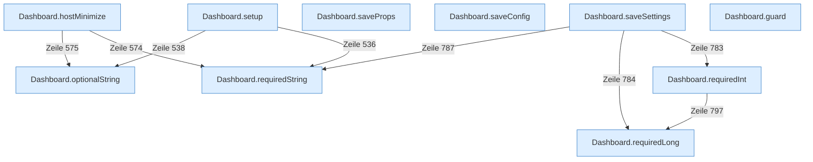

[[00 Start]] › [[Dashboard-HTTP]] › [[API-Setup]]

# API-Setup



```knoten
Dashboard.setup
  Die [[Glossar#Web-Schnittstelle|Web-Schnittstelle]] macht hier einen einzelnen Schritt. Eine Ebene tiefer steht er genauer.
Dashboard.hostMinimize
  Nimmt von der [[Glossar#Bedienseite|Bedienseite]] den Auftrag an, den [[Glossar#Host|Host]] zu verkleinern oder das zurückzunehmen.
Dashboard.requiredString
  Liest einen Text, der in der Anfrage dabei sein muss.
Dashboard.optionalString
  Liest einen Text, der in der Anfrage fehlen darf.
Dashboard.saveProps
  Die [[Glossar#Web-Schnittstelle|Web-Schnittstelle]] speichert die Eigenschaften.
Dashboard.saveConfig
  Die [[Glossar#Web-Schnittstelle|Web-Schnittstelle]] speichert die [[Glossar#Einstellungen|Einstellungen]].
Dashboard.saveSettings
  Die [[Glossar#Web-Schnittstelle|Web-Schnittstelle]] speichert die [[Glossar#Einstellungen|Einstellungen]].
Dashboard.requiredInt
  Liest eine Zahl, die in der Anfrage dabei sein muss.
Dashboard.requiredLong
  Liest eine große Zahl, die in der Anfrage dabei sein muss.
Dashboard.guard
  Die [[Glossar#Web-Schnittstelle|Web-Schnittstelle]] macht hier einen einzelnen Schritt. Eine Ebene tiefer steht er genauer.
```

> [!knoten] Was die Blöcke tun
> - **Dashboard.setup**: Die [[Glossar#Web-Schnittstelle|Web-Schnittstelle]] macht hier einen einzelnen Schritt. Eine Ebene tiefer steht er genauer.
> - **Dashboard.hostMinimize**: Nimmt von der [[Glossar#Bedienseite|Bedienseite]] den Auftrag an, den [[Glossar#Host|Host]] zu verkleinern oder das zurückzunehmen.
> - **Dashboard.requiredString**: Liest einen Text, der in der Anfrage dabei sein muss.
> - **Dashboard.optionalString**: Liest einen Text, der in der Anfrage fehlen darf.
> - **Dashboard.saveProps**: Die [[Glossar#Web-Schnittstelle|Web-Schnittstelle]] speichert die Eigenschaften.
> - **Dashboard.saveConfig**: Die [[Glossar#Web-Schnittstelle|Web-Schnittstelle]] speichert die [[Glossar#Einstellungen|Einstellungen]].
> - **Dashboard.saveSettings**: Die [[Glossar#Web-Schnittstelle|Web-Schnittstelle]] speichert die [[Glossar#Einstellungen|Einstellungen]].
> - **Dashboard.requiredInt**: Liest eine Zahl, die in der Anfrage dabei sein muss.
> - **Dashboard.requiredLong**: Liest eine große Zahl, die in der Anfrage dabei sein muss.
> - **Dashboard.guard**: Die [[Glossar#Web-Schnittstelle|Web-Schnittstelle]] macht hier einen einzelnen Schritt. Eine Ebene tiefer steht er genauer.

- Die [[Glossar#Einrichtung|Einrichtung]] über die [[Glossar#Bedienseite|Bedienseite]], inklusive Übernehmen einer älteren Anlage.
