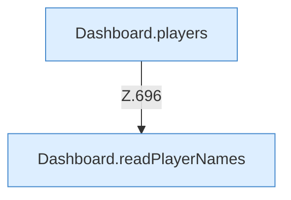

[[00 Start]] › [[Dashboard-HTTP]] › [[API-Spieler]]

# API-Spieler



```knoten
Dashboard.players
  Liefert die Spieler `players`. Ruft `workDir`, `readPlayerNames`, `players`.
Dashboard.readPlayerNames
  Liest `readPlayerNames`.
```


