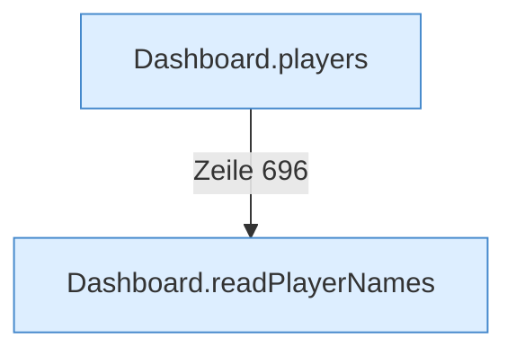

[[00 Start]] › [[Dashboard-HTTP]] › [[API-Spieler]]

# API-Spieler



```knoten
Dashboard.players
  Liefert die [[Glossar#Spieler|Spieler]] an die [[Glossar#Bedienseite|Bedienseite]].
Dashboard.readPlayerNames
  Die [[Glossar#Web-Schnittstelle|Web-Schnittstelle]] liest den [[Glossar#Spieler|Spieler]] die Namen.
```

> [!knoten] Was die Blöcke tun
> - **Dashboard.players**: Liefert die [[Glossar#Spieler|Spieler]] an die [[Glossar#Bedienseite|Bedienseite]].
> - **Dashboard.readPlayerNames**: Die [[Glossar#Web-Schnittstelle|Web-Schnittstelle]] liest den [[Glossar#Spieler|Spieler]] die Namen.

- Liefert die [[Glossar#Spieler|Spieler]] und schickt einen [[Glossar#Befehl|Befehl]] zu einem Spieler.
