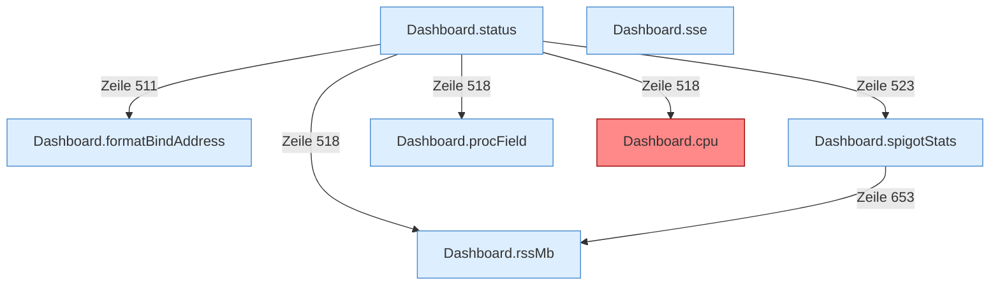

[[00 Start]] › [[Dashboard-HTTP]] › [[API-Status]]

# API-Status



```knoten
Dashboard.status
  Liefert den Zustand des [[Glossar#Spielserver|Spielservers]] an die [[Glossar#Bedienseite|Bedienseite]].
Dashboard.formatBindAddress
  Die [[Glossar#Web-Schnittstelle|Web-Schnittstelle]] macht lesbar die Bindung die Adresse.
Dashboard.spigotStats
  Liefert eine kurze Statistik, die der [[Glossar#Spielserver|Spielserver]] anbietet.
Dashboard.procField
  Liest ein einzelnes Feld aus den Prozessdaten des Betriebssystems.
Dashboard.cpu
  Rechnet aus, wie stark der [[Glossar#Prozess|Prozess]] den Rechner beschäftigt. Die Rechnung nimmt an, dass die Uhr des Systems hundert Schritte pro Sekunde hat. Auffällig: das kann sich anders verhalten, als man erwartet. Das nennt man [[Glossar#Unerwartetes Verhalten|Unerwartetes Verhalten]].
Dashboard.rssMb
  Liest, wie viel [[Glossar#Arbeitsspeicher|Arbeitsspeicher]] der [[Glossar#Prozess|Prozess]] gerade belegt.
Dashboard.sse
  Hält eine Verbindung offen, über die neue Konsolenzeilen an den Browser laufen.
```

> [!knoten] Was die Blöcke tun
> - **Dashboard.status**: Liefert den Zustand des [[Glossar#Spielserver|Spielservers]] an die [[Glossar#Bedienseite|Bedienseite]].
> - **Dashboard.formatBindAddress**: Die [[Glossar#Web-Schnittstelle|Web-Schnittstelle]] macht lesbar die Bindung die Adresse.
> - **Dashboard.spigotStats**: Liefert eine kurze Statistik, die der [[Glossar#Spielserver|Spielserver]] anbietet.
> - **Dashboard.procField**: Liest ein einzelnes Feld aus den Prozessdaten des Betriebssystems.
> - **Dashboard.cpu**: Rechnet aus, wie stark der [[Glossar#Prozess|Prozess]] den Rechner beschäftigt. Die Rechnung nimmt an, dass die Uhr des Systems hundert Schritte pro Sekunde hat. Auffällig: das kann sich anders verhalten, als man erwartet. Das nennt man [[Glossar#Unerwartetes Verhalten|Unerwartetes Verhalten]].
> - **Dashboard.rssMb**: Liest, wie viel [[Glossar#Arbeitsspeicher|Arbeitsspeicher]] der [[Glossar#Prozess|Prozess]] gerade belegt.
> - **Dashboard.sse**: Hält eine Verbindung offen, über die neue Konsolenzeilen an den Browser laufen.

- Liefert der [[Glossar#Bedienseite|Bedienseite]] den Zustand, die [[Glossar#Konsole|Konsole]] und die [[Glossar#Diagnose|Diagnose]].
