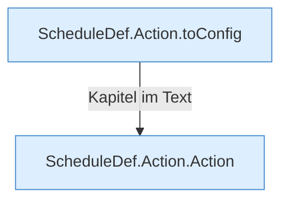

[[00 Start]] › [[Zeitplaene]] › [[Plan-Klassen]] › [[ScheduleDef]] › [[Action]]

# Action



```knoten
ScheduleDef.Action.toConfig
  Der [[Glossar#Zeitplan|Zeitplan]] kümmert sich um die [[Glossar#Einstellungen|Einstellungen]]. `toConfig` in `ScheduleDef.java`.
ScheduleDef.Action.Action
  Der [[Glossar#Zeitplan|Zeitplan]] macht hier einen einzelnen Schritt. Eine Ebene tiefer steht er genauer. `Action` in `ScheduleDef.java`.
```

> [!knoten]- Was die Blöcke tun
> - **ScheduleDef.Action.toConfig**: Der [[Glossar#Zeitplan|Zeitplan]] kümmert sich um die [[Glossar#Einstellungen|Einstellungen]]. `toConfig` in `ScheduleDef.java`.
> - **ScheduleDef.Action.Action**: Der [[Glossar#Zeitplan|Zeitplan]] macht hier einen einzelnen Schritt. Eine Ebene tiefer steht er genauer. `Action` in `ScheduleDef.java`.

- Die eine Tätigkeit in einem [[Glossar#Zeitplan|Zeitplan]], zum Beispiel ein [[Glossar#Befehl|Befehl]].
