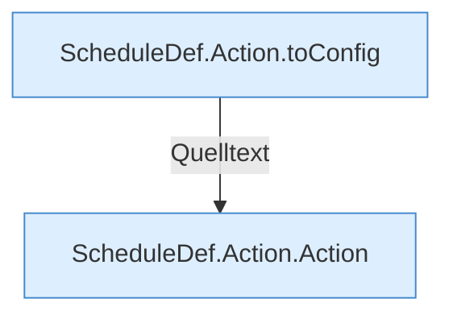

[[00 Start]] › [[Zeitplaene]] › [[Plan-Klassen]] › [[ScheduleDef]] › [[Action]]

# Action



```knoten
ScheduleDef.Action.toConfig
  `toConfig` in `ScheduleDef.java`.
ScheduleDef.Action.Action
  `Action` in `ScheduleDef.java`.
```


