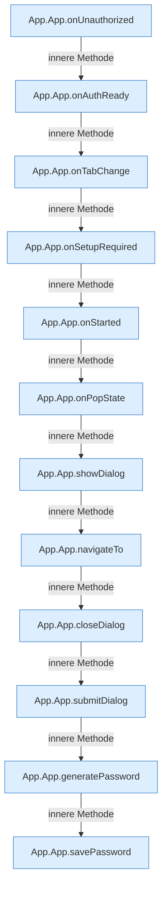

[[00 Start]] › [[Dashboard-UI]] › [[UI-App]] › [[App.App]] › [[App.App.Innere]]

# App.App.Innere



```knoten
App.App.onUnauthorized
  Reagiert `onUnauthorized`. Ruft `showLogin`.
App.App.onAuthReady
  Reagiert `onAuthReady`.
App.App.onTabChange
  Reagiert `onTabChange`.
App.App.onSetupRequired
  Reagiert `onSetupRequired`. Ruft `navigateTo`.
App.App.onStarted
  Reagiert `onStarted`. Ruft `navigateTo`, `tabFromPath`.
App.App.onPopState
  Reagiert `onPopState`. Ruft `tabFromPath`, `navigateTo`.
App.App.showDialog
  Zeigt `showDialog`.
App.App.navigateTo
  Wechselt die Route `navigateTo`. Ruft `tab`.
App.App.closeDialog
  Schließt `closeDialog`.
App.App.submitDialog
  Gibt ab `submitDialog`. Ruft `closeDialog`.
App.App.generatePassword
  Erzeugt `generatePassword`.
App.App.savePassword
  Speichert `savePassword`. Ruft `dashboardRequest`, `jsonBody`, `start`.
```

- Fortsetzung von `App.App`, Quellreihenfolge.
