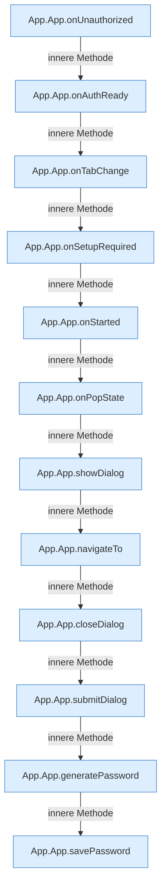

[[00 Start]] › [[Dashboard-UI]] › [[UI-App]] › [[App.App]] › [[App.App.Innere]]

# App.App.Innere



```knoten
App.App.onUnauthorized
  Die [[Glossar#Bedienseite|Bedienseite]] macht hier einen einzelnen Schritt. Eine Ebene tiefer steht er genauer. Reagiert `onUnauthorized`. Ruft `showLogin`.
App.App.onAuthReady
  Die [[Glossar#Bedienseite|Bedienseite]] macht hier einen einzelnen Schritt. Eine Ebene tiefer steht er genauer. Reagiert `onAuthReady`.
App.App.onTabChange
  Die [[Glossar#Bedienseite|Bedienseite]] wechselt zu hier einen Schritt. Eine Ebene tiefer steht er genauer. Reagiert `onTabChange`.
App.App.onSetupRequired
  Die [[Glossar#Bedienseite|Bedienseite]] kümmert sich um die [[Glossar#Einrichtung|Einrichtung]] einen Pflichtwert. Reagiert `onSetupRequired`. Ruft `navigateTo`.
App.App.onStarted
  Die [[Glossar#Bedienseite|Bedienseite]] macht hier einen einzelnen Schritt. Eine Ebene tiefer steht er genauer. Reagiert `onStarted`. Ruft `navigateTo`, `tabFromPath`.
App.App.onPopState
  Die [[Glossar#Bedienseite|Bedienseite]] macht hier einen einzelnen Schritt. Eine Ebene tiefer steht er genauer. Reagiert `onPopState`. Ruft `tabFromPath`, `navigateTo`.
App.App.showDialog
  Die [[Glossar#Bedienseite|Bedienseite]] zeigt den Dialog. Zeigt `showDialog`.
App.App.navigateTo
  Die [[Glossar#Bedienseite|Bedienseite]] wechselt zu das. Wechselt die Route `navigateTo`. Ruft `tab`.
App.App.closeDialog
  Die [[Glossar#Bedienseite|Bedienseite]] schließt den Dialog. Schließt `closeDialog`.
App.App.submitDialog
  Die [[Glossar#Bedienseite|Bedienseite]] kümmert sich um den Dialog. Gibt ab `submitDialog`. Ruft `closeDialog`.
App.App.generatePassword
  Die [[Glossar#Bedienseite|Bedienseite]] erzeugt das Passwort. Erzeugt `generatePassword`.
App.App.savePassword
  Die [[Glossar#Bedienseite|Bedienseite]] speichert das Passwort. Speichert `savePassword`. Ruft `dashboardRequest`, `jsonBody`, `start`.
```

> [!knoten]- Was die Blöcke tun
> - **App.App.onUnauthorized**: Die [[Glossar#Bedienseite|Bedienseite]] macht hier einen einzelnen Schritt. Eine Ebene tiefer steht er genauer. Reagiert `onUnauthorized`. Ruft `showLogin`.
> - **App.App.onAuthReady**: Die [[Glossar#Bedienseite|Bedienseite]] macht hier einen einzelnen Schritt. Eine Ebene tiefer steht er genauer. Reagiert `onAuthReady`.
> - **App.App.onTabChange**: Die [[Glossar#Bedienseite|Bedienseite]] wechselt zu hier einen Schritt. Eine Ebene tiefer steht er genauer. Reagiert `onTabChange`.
> - **App.App.onSetupRequired**: Die [[Glossar#Bedienseite|Bedienseite]] kümmert sich um die [[Glossar#Einrichtung|Einrichtung]] einen Pflichtwert. Reagiert `onSetupRequired`. Ruft `navigateTo`.
> - **App.App.onStarted**: Die [[Glossar#Bedienseite|Bedienseite]] macht hier einen einzelnen Schritt. Eine Ebene tiefer steht er genauer. Reagiert `onStarted`. Ruft `navigateTo`, `tabFromPath`.
> - **App.App.onPopState**: Die [[Glossar#Bedienseite|Bedienseite]] macht hier einen einzelnen Schritt. Eine Ebene tiefer steht er genauer. Reagiert `onPopState`. Ruft `tabFromPath`, `navigateTo`.
> - **App.App.showDialog**: Die [[Glossar#Bedienseite|Bedienseite]] zeigt den Dialog. Zeigt `showDialog`.
> - **App.App.navigateTo**: Die [[Glossar#Bedienseite|Bedienseite]] wechselt zu das. Wechselt die Route `navigateTo`. Ruft `tab`.
> - **App.App.closeDialog**: Die [[Glossar#Bedienseite|Bedienseite]] schließt den Dialog. Schließt `closeDialog`.
> - **App.App.submitDialog**: Die [[Glossar#Bedienseite|Bedienseite]] kümmert sich um den Dialog. Gibt ab `submitDialog`. Ruft `closeDialog`.
> - **App.App.generatePassword**: Die [[Glossar#Bedienseite|Bedienseite]] erzeugt das Passwort. Erzeugt `generatePassword`.
> - **App.App.savePassword**: Die [[Glossar#Bedienseite|Bedienseite]] speichert das Passwort. Speichert `savePassword`. Ruft `dashboardRequest`, `jsonBody`, `start`.

- [[Glossar#Funktion|Funktionen]], die nur innen in diesem Block gebraucht werden.
- Fortsetzung von `App.App`.
