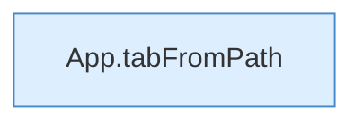

[[00 Start]] › [[Dashboard-UI]] › [[UI-App]] › [[App.App]] › [[App.App.Teil1]]

# App.App.Teil1



```knoten
App.tabFromPath
  Die [[Glossar#Bedienseite|Bedienseite]] wechselt zu aus den Pfad. Wechselt den Tab `tabFromPath`.
```

> [!knoten]- Was die Blöcke tun
> - **App.tabFromPath**: Die [[Glossar#Bedienseite|Bedienseite]] wechselt zu aus den Pfad. Wechselt den Tab `tabFromPath`.

- Ein weiterer Abschnitt derselben Übersicht.
- Fortsetzung von `App.App`.
