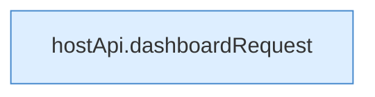

[[00 Start]] › [[Dashboard-UI]] › [[UI-App]] › [[App.App]] › [[App.App.Teil2]]

# App.App.Teil2



```knoten
hostApi.dashboardRequest
  Schickt von der [[Glossar#Bedienseite|Bedienseite]] eine Anfrage an das [[Glossar#Plugin|Plugin]]. `dashboardRequest` in `hostApi.ts`.
```

> [!knoten]- Was die Blöcke tun
> - **hostApi.dashboardRequest**: Schickt von der [[Glossar#Bedienseite|Bedienseite]] eine Anfrage an das [[Glossar#Plugin|Plugin]]. `dashboardRequest` in `hostApi.ts`.

- Ein weiterer Abschnitt derselben Übersicht.
- Fortsetzung von `App.App`.
