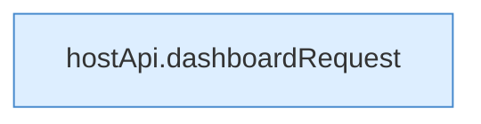

[[00 Start]] › [[Dashboard-UI]] › [[UI-App]] › [[App.App]] › [[App.App.Teil2]]

# App.App.Teil2



```knoten
hostApi.dashboardRequest
  `dashboardRequest` in `hostApi.ts`.
```

- Fortsetzung von `App.App`, Quellreihenfolge.
