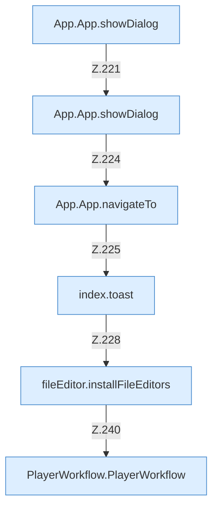

[[00 Start]] › [[Dashboard-UI]] › [[UI-App]] › [[App.App]] › [[App.App.Teil3.Calls219]]

# App.App.Teil3.Calls219



```knoten
App.App.showDialog
  Die [[Glossar#Bedienseite|Bedienseite]] zeigt den Dialog. Zeigt `showDialog`.
App.App.navigateTo
  Die [[Glossar#Bedienseite|Bedienseite]] wechselt zu das. Wechselt die Route `navigateTo`. Ruft `tab`.
index.toast
  Zeigt in der älteren [[Glossar#Bedienseite|Bedienseite]] einen kurzen Hinweis. Zeigt eine Meldung `toast`. Ruft `$`.
fileEditor.installFileEditors
  Die [[Glossar#Bedienseite|Bedienseite]] richtet ein die Datei die Editoren. Hängt ein `installFileEditors`. Ruft `set`.
PlayerWorkflow.PlayerWorkflow
  Die [[Glossar#Bedienseite|Bedienseite]] kümmert sich um den Ablauf. `PlayerWorkflow` in `PlayerWorkflow.tsx`. Ruft `dashboardRequest`, `refresh`, `runPlayerAction`.
```

> [!knoten]- Was die Blöcke tun
> - **App.App.showDialog**: Die [[Glossar#Bedienseite|Bedienseite]] zeigt den Dialog. Zeigt `showDialog`.
> - **App.App.navigateTo**: Die [[Glossar#Bedienseite|Bedienseite]] wechselt zu das. Wechselt die Route `navigateTo`. Ruft `tab`.
> - **index.toast**: Zeigt in der älteren [[Glossar#Bedienseite|Bedienseite]] einen kurzen Hinweis. Zeigt eine Meldung `toast`. Ruft `$`.
> - **fileEditor.installFileEditors**: Die [[Glossar#Bedienseite|Bedienseite]] richtet ein die Datei die Editoren. Hängt ein `installFileEditors`. Ruft `set`.
> - **PlayerWorkflow.PlayerWorkflow**: Die [[Glossar#Bedienseite|Bedienseite]] kümmert sich um den Ablauf. `PlayerWorkflow` in `PlayerWorkflow.tsx`. Ruft `dashboardRequest`, `refresh`, `runPlayerAction`.

- Weitere [[Glossar#Funktion|Funktionen]], die ab [[Glossar#Zeile|Zeile]] 219 aufgerufen werden.
- Fortsetzung von `App.App.Teil3`.
