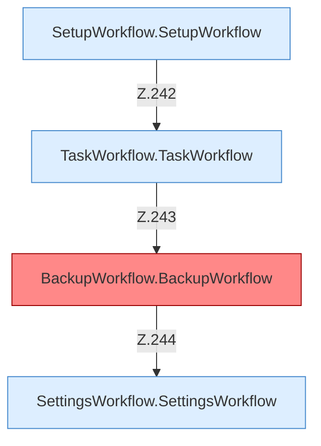

[[00 Start]] › [[Dashboard-UI]] › [[UI-App]] › [[App.App]] › [[App.App.Teil3.Calls241]]

# App.App.Teil3.Calls241



```knoten
SetupWorkflow.SetupWorkflow
  `SetupWorkflow` in `SetupWorkflow.tsx`. Ruft `dashboardRequest`, `refresh`, `SetupWizard`.
TaskWorkflow.TaskWorkflow
  `TaskWorkflow` in `TaskWorkflow.tsx`. Ruft `dashboardRequest`, `refresh`, `newDraft`.
BackupWorkflow.BackupWorkflow
  Sichert `BackupWorkflow`. Ruft `dashboardRequest`, `refresh`, `testTarget`. Befund: Altlast (sicher).
SettingsWorkflow.SettingsWorkflow
  `SettingsWorkflow` in `SettingsWorkflow.tsx`. Ruft `loadBackupSettings`, `refresh`, `save`.
```

- Fortsetzung von `App.App.Teil3`, Quellreihenfolge.
