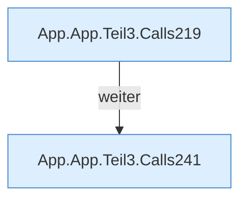

[[00 Start]] › [[Dashboard-UI]] › [[UI-App]] › [[App.App]] › [[App.App.Teil3]]

# App.App.Teil3



```knoten
App.App.Teil3.Calls219
  Weitere [[Glossar#Funktion|Funktionen]], die ab [[Glossar#Zeile|Zeile]] 219 aufgerufen werden. Weitere eigene Aufrufe ab Zeile 219.
App.App.Teil3.Calls241
  Weitere [[Glossar#Funktion|Funktionen]], die ab [[Glossar#Zeile|Zeile]] 241 aufgerufen werden. Weitere eigene Aufrufe ab Zeile 241.
```

> [!knoten]- Was die Blöcke tun
> - **App.App.Teil3.Calls219**: Weitere [[Glossar#Funktion|Funktionen]], die ab [[Glossar#Zeile|Zeile]] 219 aufgerufen werden. Weitere eigene Aufrufe ab Zeile 219.
> - **App.App.Teil3.Calls241**: Weitere [[Glossar#Funktion|Funktionen]], die ab [[Glossar#Zeile|Zeile]] 241 aufgerufen werden. Weitere eigene Aufrufe ab Zeile 241.

- Ein weiterer Abschnitt derselben Übersicht.
- Fortsetzung von `App.App`.
