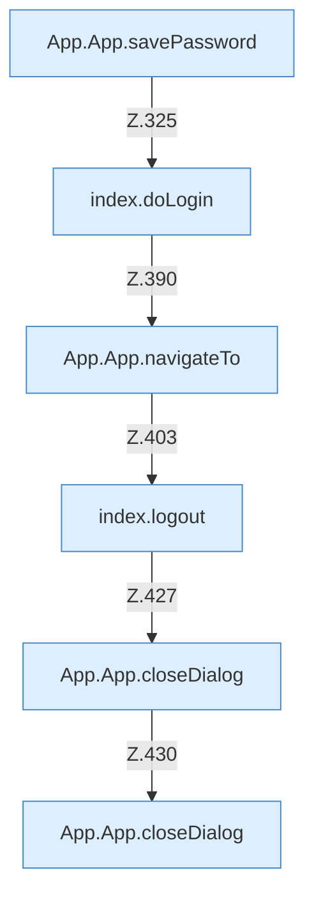

[[00 Start]] › [[Dashboard-UI]] › [[UI-App]] › [[App.App]] › [[App.App.Teil4.Calls324]]

# App.App.Teil4.Calls324



```knoten
App.App.savePassword
  Die [[Glossar#Bedienseite|Bedienseite]] speichert das Passwort. Speichert `savePassword`. Ruft `dashboardRequest`, `jsonBody`, `start`.
index.doLogin
  Die ältere [[Glossar#Bedienseite|Bedienseite]] führt aus die [[Glossar#Anmeldung|Anmeldung]]. Führt aus `doLogin`. Ruft `$`, `start`.
App.App.navigateTo
  Die [[Glossar#Bedienseite|Bedienseite]] wechselt zu das. Wechselt die Route `navigateTo`. Ruft `tab`.
index.logout
  Meldet von der älteren [[Glossar#Bedienseite|Bedienseite]] ab. Meldet ab `logout`. Ruft `post`, `showLogin`.
App.App.closeDialog
  Die [[Glossar#Bedienseite|Bedienseite]] schließt den Dialog. Schließt `closeDialog`.
```

> [!knoten]- Was die Blöcke tun
> - **App.App.savePassword**: Die [[Glossar#Bedienseite|Bedienseite]] speichert das Passwort. Speichert `savePassword`. Ruft `dashboardRequest`, `jsonBody`, `start`.
> - **index.doLogin**: Die ältere [[Glossar#Bedienseite|Bedienseite]] führt aus die [[Glossar#Anmeldung|Anmeldung]]. Führt aus `doLogin`. Ruft `$`, `start`.
> - **App.App.navigateTo**: Die [[Glossar#Bedienseite|Bedienseite]] wechselt zu das. Wechselt die Route `navigateTo`. Ruft `tab`.
> - **index.logout**: Meldet von der älteren [[Glossar#Bedienseite|Bedienseite]] ab. Meldet ab `logout`. Ruft `post`, `showLogin`.
> - **App.App.closeDialog**: Die [[Glossar#Bedienseite|Bedienseite]] schließt den Dialog. Schließt `closeDialog`.

- Weitere [[Glossar#Funktion|Funktionen]], die ab [[Glossar#Zeile|Zeile]] 324 aufgerufen werden.
- Fortsetzung von `App.App.Teil4`.
