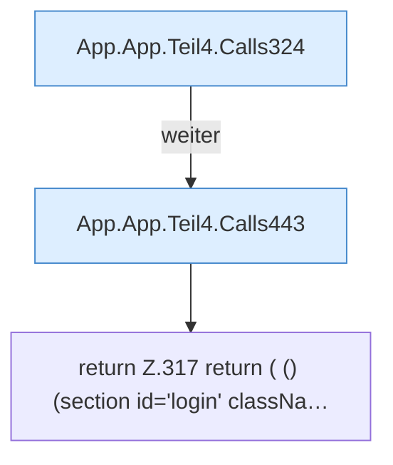

[[00 Start]] › [[Dashboard-UI]] › [[UI-App]] › [[App.App]] › [[App.App.Teil4]]

# App.App.Teil4



```knoten
App.App.Teil4.Calls324
  Weitere [[Glossar#Funktion|Funktionen]], die ab [[Glossar#Zeile|Zeile]] 324 aufgerufen werden. Weitere eigene Aufrufe ab Zeile 324.
App.App.Teil4.Calls443
  Weitere [[Glossar#Funktion|Funktionen]], die ab [[Glossar#Zeile|Zeile]] 443 aufgerufen werden. Weitere eigene Aufrufe ab Zeile 443.
return Z.317 return ( () (section id='login' classNa…
  Zeile 317: Rückgabe `return ( () (section id='login' classNa…`.
```

> [!knoten]- Was die Blöcke tun
> - **App.App.Teil4.Calls324**: Weitere [[Glossar#Funktion|Funktionen]], die ab [[Glossar#Zeile|Zeile]] 324 aufgerufen werden. Weitere eigene Aufrufe ab Zeile 324.
> - **App.App.Teil4.Calls443**: Weitere [[Glossar#Funktion|Funktionen]], die ab [[Glossar#Zeile|Zeile]] 443 aufgerufen werden. Weitere eigene Aufrufe ab Zeile 443.
> - **return Z.317 return ( () (section id='login' classNa…**: Zeile 317: Rückgabe `return ( () (section id='login' classNa…`.

- Ein weiterer Abschnitt derselben Übersicht.
- Fortsetzung von `App.App`.
