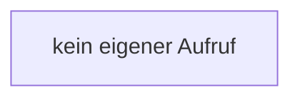

[[00 Start]] › [[Dashboard-UI]] › [[UI-App]] › [[App.App]] › [[App.App.closeDialog]]

# App.App.closeDialog

`App.closeDialog(result: boolean | string | null)` [ui/src/App.tsx:261–265](https://github.com/Sciddie/minecraft-serverhoster-plugin/blob/95b02b953b0b4c23673e900e021a7c3c844aa37d/ui/src/App.tsx#L261-L265)



```knoten
kein eigener Aufruf
  In diesem Stück gibt es keinen weiteren eigenen Aufruf.
```

- `closeDialog` in `ui/src/App.tsx`
