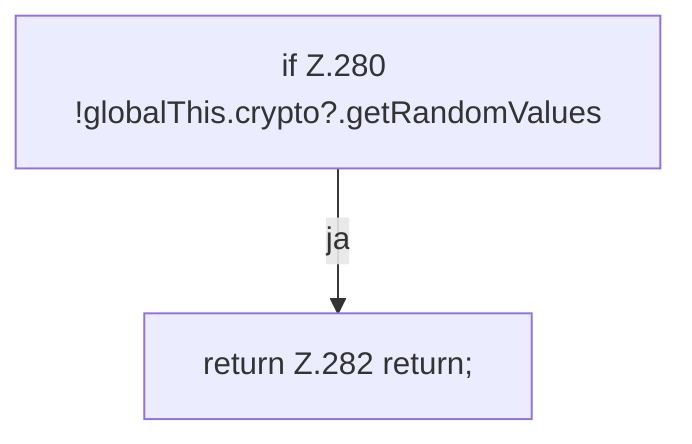

[[00 Start]] › [[Dashboard-UI]] › [[UI-App]] › [[App.App]] › [[App.App.generatePassword]]

# App.App.generatePassword

`App.generatePassword()` [ui/src/App.tsx:279–291](https://github.com/Sciddie/minecraft-serverhoster-plugin/blob/95b02b953b0b4c23673e900e021a7c3c844aa37d/ui/src/App.tsx#L279-L291)



```knoten
if Z.280 !globalThis.crypto?.getRandomValues
  Zeile 280: prüft `!globalThis.crypto?.getRandomValues`.
return Z.282 return;
  Zeile 282: Rückgabe `return;`.
```

> [!knoten]- Was die Blöcke tun
> - **if Z.280 !globalThis.crypto?.getRandomValues**: Zeile 280: prüft `!globalThis.crypto?.getRandomValues`.
> - **return Z.282 return;**: Zeile 282: Rückgabe `return;`.

- Die [[Glossar#Bedienseite|Bedienseite]] erzeugt das Passwort.
- `generatePassword` in `ui/src/App.tsx`
