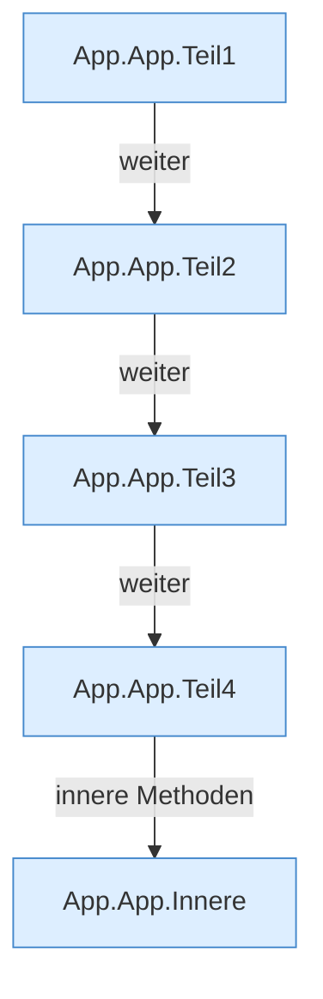

[[00 Start]] › [[Dashboard-UI]] › [[UI-App]] › [[App.App]]

# App.App

`App.App()` [ui/src/App.tsx:146–491](https://github.com/Sciddie/minecraft-serverhoster-plugin/blob/95b02b953b0b4c23673e900e021a7c3c844aa37d/ui/src/App.tsx#L146-L491)



```knoten
App.App.Teil1
  Abschnitt 1 dieses Ablaufs, in Quellreihenfolge.
App.App.Teil2
  Abschnitt 2 dieses Ablaufs, in Quellreihenfolge.
App.App.Teil3
  Abschnitt 3 dieses Ablaufs, in Quellreihenfolge.
App.App.Teil4
  Abschnitt 4 dieses Ablaufs, in Quellreihenfolge.
App.App.Innere
  Innere Funktionen dieses Blocks.
```

- `App` in `ui/src/App.tsx`
