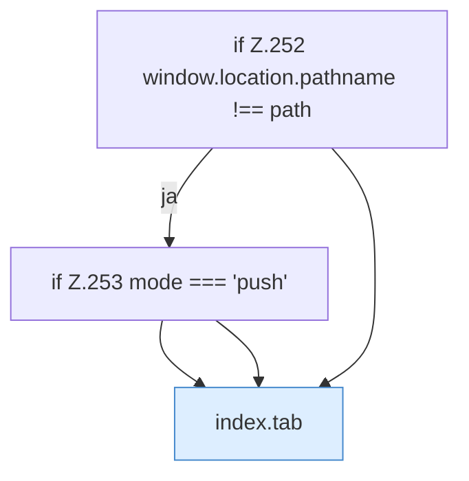

[[00 Start]] › [[Dashboard-UI]] › [[UI-App]] › [[App.App]] › [[App.App.navigateTo]]

# App.App.navigateTo

`App.navigateTo(requestedTab: string, mode: "push" | "replace")` [ui/src/App.tsx:248–259](https://github.com/Sciddie/minecraft-serverhoster-plugin/blob/95b02b953b0b4c23673e900e021a7c3c844aa37d/ui/src/App.tsx#L248-L259)



```knoten
if Z.252 window.location.pathname !== path
  Zeile 252: prüft `window.location.pathname !== path`.
if Z.253 mode === 'push'
  Zeile 253: prüft `mode === 'push'`.
index.tab
  Wechselt den Tab `tab`. Ruft `$`, `loadTxt`, `loadPropertiesPreview`.
```

- `navigateTo` in `ui/src/App.tsx`
