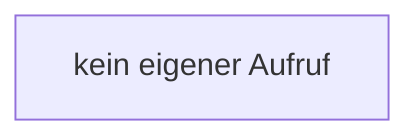

[[00 Start]] › [[Dashboard-UI]] › [[UI-App]] › [[App.App]] › [[App.App.onAuthReady]]

# App.App.onAuthReady

`App.onAuthReady()` [ui/src/App.tsx:176–176](https://github.com/Sciddie/minecraft-serverhoster-plugin/blob/95b02b953b0b4c23673e900e021a7c3c844aa37d/ui/src/App.tsx#L176-L176)



```knoten
kein eigener Aufruf
  In diesem Stück gibt es keinen weiteren eigenen Aufruf.
```

> [!knoten]- Was die Blöcke tun
> - **kein eigener Aufruf**: In diesem Stück gibt es keinen weiteren eigenen Aufruf.

- Die [[Glossar#Bedienseite|Bedienseite]] macht hier einen einzelnen Schritt. Eine Ebene tiefer steht er genauer.
- `onAuthReady` in `ui/src/App.tsx`
