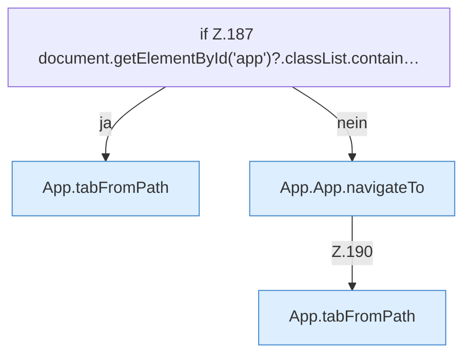

[[00 Start]] › [[Dashboard-UI]] › [[UI-App]] › [[App.App]] › [[App.App.onPopState]]

# App.App.onPopState

`App.onPopState()` [ui/src/App.tsx:186–192](https://github.com/Sciddie/minecraft-serverhoster-plugin/blob/95b02b953b0b4c23673e900e021a7c3c844aa37d/ui/src/App.tsx#L186-L192)



```knoten
if Z.187 document.getElementById('app')?.classList.contain…
  Zeile 187: prüft `document.getElementById('app')?.classList.contain…`.
App.tabFromPath
  Wechselt den Tab `tabFromPath`.
App.App.navigateTo
  Wechselt die Route `navigateTo`. Ruft `tab`.
```

- `onPopState` in `ui/src/App.tsx`
