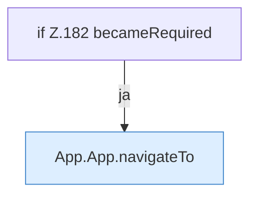

[[00 Start]] › [[Dashboard-UI]] › [[UI-App]] › [[App.App]] › [[App.App.onSetupRequired]]

# App.App.onSetupRequired

`App.onSetupRequired(event: Event)` [ui/src/App.tsx:178–184](https://github.com/Sciddie/minecraft-serverhoster-plugin/blob/95b02b953b0b4c23673e900e021a7c3c844aa37d/ui/src/App.tsx#L178-L184)



```knoten
if Z.182 becameRequired
  Zeile 182: prüft `becameRequired`.
App.App.navigateTo
  Wechselt die Route `navigateTo`. Ruft `tab`.
```

- `onSetupRequired` in `ui/src/App.tsx`
