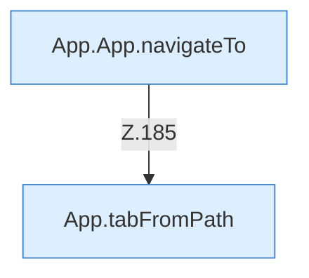

[[00 Start]] › [[Dashboard-UI]] › [[UI-App]] › [[App.App]] › [[App.App.onStarted]]

# App.App.onStarted

`App.onStarted()` [ui/src/App.tsx:185–185](https://github.com/Sciddie/minecraft-serverhoster-plugin/blob/95b02b953b0b4c23673e900e021a7c3c844aa37d/ui/src/App.tsx#L185-L185)



```knoten
App.App.navigateTo
  Die [[Glossar#Bedienseite|Bedienseite]] wechselt zu das. Wechselt die Route `navigateTo`. Ruft `tab`.
App.tabFromPath
  Die [[Glossar#Bedienseite|Bedienseite]] wechselt zu aus den Pfad. Wechselt den Tab `tabFromPath`.
```

> [!knoten]- Was die Blöcke tun
> - **App.App.navigateTo**: Die [[Glossar#Bedienseite|Bedienseite]] wechselt zu das. Wechselt die Route `navigateTo`. Ruft `tab`.
> - **App.tabFromPath**: Die [[Glossar#Bedienseite|Bedienseite]] wechselt zu aus den Pfad. Wechselt den Tab `tabFromPath`.

- Die [[Glossar#Bedienseite|Bedienseite]] macht hier einen einzelnen Schritt. Eine Ebene tiefer steht er genauer.
- `onStarted` in `ui/src/App.tsx`
