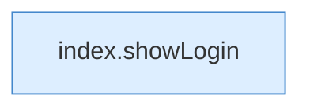

[[00 Start]] › [[Dashboard-UI]] › [[UI-App]] › [[App.App]] › [[App.App.onUnauthorized]]

# App.App.onUnauthorized

`App.onUnauthorized()` [ui/src/App.tsx:175–175](https://github.com/Sciddie/minecraft-serverhoster-plugin/blob/95b02b953b0b4c23673e900e021a7c3c844aa37d/ui/src/App.tsx#L175-L175)



```knoten
index.showLogin
  Die ältere [[Glossar#Bedienseite|Bedienseite]] zeigt die [[Glossar#Anmeldung|Anmeldung]]. Zeigt `showLogin`. Ruft `$`.
```

> [!knoten]- Was die Blöcke tun
> - **index.showLogin**: Die ältere [[Glossar#Bedienseite|Bedienseite]] zeigt die [[Glossar#Anmeldung|Anmeldung]]. Zeigt `showLogin`. Ruft `$`.

- Die [[Glossar#Bedienseite|Bedienseite]] macht hier einen einzelnen Schritt. Eine Ebene tiefer steht er genauer.
- `onUnauthorized` in `ui/src/App.tsx`
