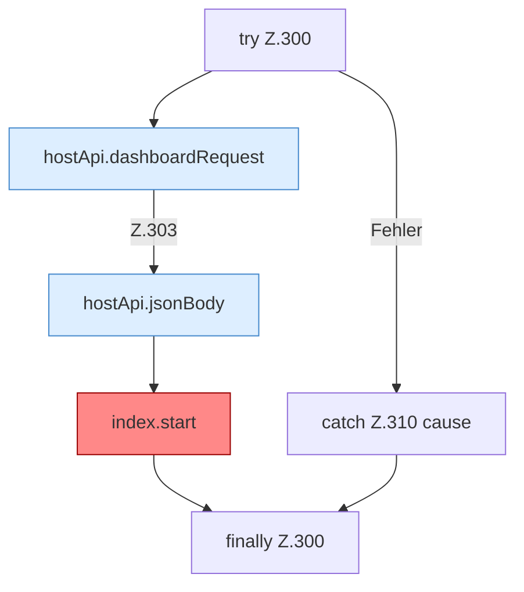

[[00 Start]] › [[Dashboard-UI]] › [[UI-App]] › [[App.App]] › [[App.App.savePassword]] › [[App.App.savePassword.Z300]]

# App.App.savePassword.Z300



```knoten
try Z.300
  Zeile 300: Versuch. Der Fehlerpfad geht in catch.
hostApi.dashboardRequest
  `dashboardRequest` in `hostApi.ts`.
hostApi.jsonBody
  Antwortet mit JSON `jsonBody`.
index.start
  Browser-Timer 3000 ms für `status`. Befund: doppelte Implementierung (sicher).
catch Z.310 cause
  Zeile 310: fängt cause.
finally Z.300
  Läuft danach immer, auch nach einem Fehler.
```

- Fortsetzung von `App.App.savePassword`, Quellreihenfolge.
