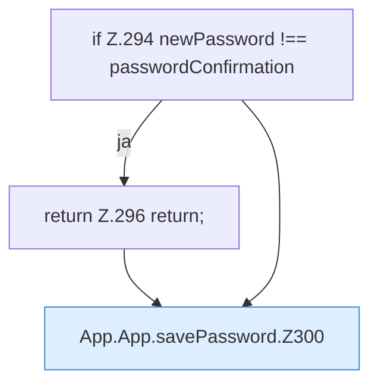

[[00 Start]] › [[Dashboard-UI]] › [[UI-App]] › [[App.App]] › [[App.App.savePassword]]

# App.App.savePassword

`App.savePassword()` [ui/src/App.tsx:293–315](https://github.com/Sciddie/minecraft-serverhoster-plugin/blob/95b02b953b0b4c23673e900e021a7c3c844aa37d/ui/src/App.tsx#L293-L315)



```knoten
if Z.294 newPassword !== passwordConfirmation
  Zeile 294: prüft `newPassword !== passwordConfirmation`.
return Z.296 return;
  Zeile 296: Rückgabe `return;`.
App.App.savePassword.Z300
  Fortsetzung des Ablaufs ab Zeile 300.
```

- `savePassword` in `ui/src/App.tsx`
