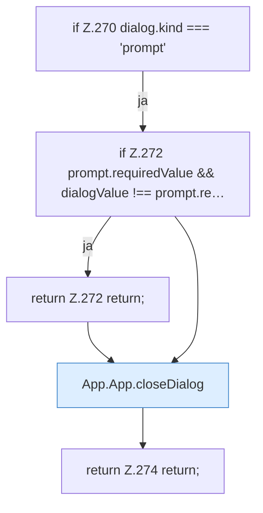

[[00 Start]] › [[Dashboard-UI]] › [[UI-App]] › [[App.App]] › [[App.App.submitDialog]] › [[App.App.submitDialog.Z270]]

# App.App.submitDialog.Z270



```knoten
if Z.270 dialog.kind === 'prompt'
  Zeile 270: prüft `dialog.kind === 'prompt'`.
if Z.272 prompt.requiredValue && dialogValue !== prompt.re…
  Zeile 272: prüft `prompt.requiredValue && dialogValue !== prompt.re…`.
return Z.272 return;
  Zeile 272: Rückgabe `return;`.
App.App.closeDialog
  Die [[Glossar#Bedienseite|Bedienseite]] schließt den Dialog. Schließt `closeDialog`.
return Z.274 return;
  Zeile 274: Rückgabe `return;`.
```

> [!knoten]- Was die Blöcke tun
> - **if Z.270 dialog.kind === 'prompt'**: Zeile 270: prüft `dialog.kind === 'prompt'`.
> - **if Z.272 prompt.requiredValue && dialogValue !== prompt.re…**: Zeile 272: prüft `prompt.requiredValue && dialogValue !== prompt.re…`.
> - **return Z.272 return;**: Zeile 272: Rückgabe `return;`.
> - **App.App.closeDialog**: Die [[Glossar#Bedienseite|Bedienseite]] schließt den Dialog. Schließt `closeDialog`.
> - **return Z.274 return;**: Zeile 274: Rückgabe `return;`.

- Der Ablauf geht in [[Glossar#Zeile|Zeile]] 270 weiter. Eine Ebene tiefer steht er genauer.
- Fortsetzung von `App.App.submitDialog`.
