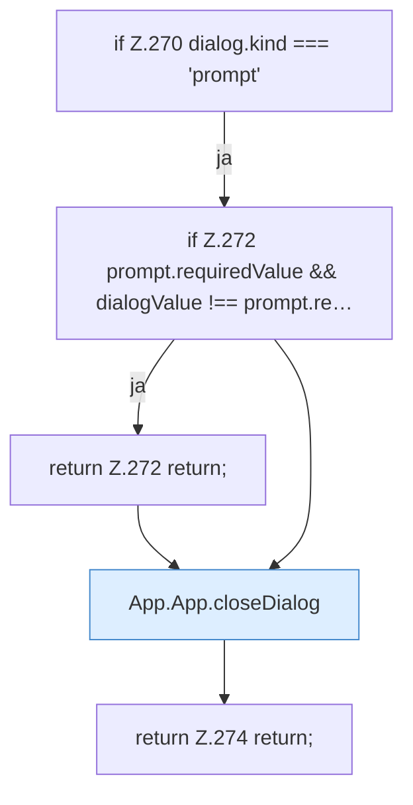

[[00 Start]] › [[Dashboard-UI]] › [[UI-App]] › [[App.App]] › [[App.App.submitDialog]] › [[App.App.submitDialog.Z270]]

# App.App.submitDialog.Z270

- Fortsetzung von `App.App.submitDialog`, Quellreihenfolge.
