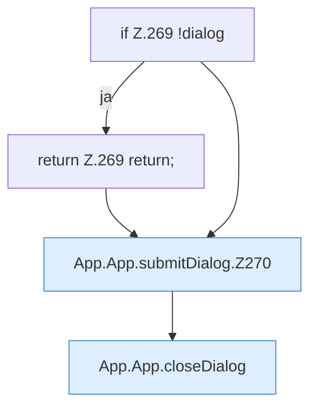

[[00 Start]] › [[Dashboard-UI]] › [[UI-App]] › [[App.App]] › [[App.App.submitDialog]]

# App.App.submitDialog

`App.submitDialog(event: FormEvent)` [ui/src/App.tsx:267–277](https://github.com/Sciddie/minecraft-serverhoster-plugin/blob/95b02b953b0b4c23673e900e021a7c3c844aa37d/ui/src/App.tsx#L267-L277)



```knoten
if Z.269 !dialog
  Zeile 269: prüft `!dialog`.
return Z.269 return;
  Zeile 269: Rückgabe `return;`.
App.App.submitDialog.Z270
  Fortsetzung des Ablaufs ab Zeile 270.
App.App.closeDialog
  Schließt `closeDialog`.
```

- `submitDialog` in `ui/src/App.tsx`
