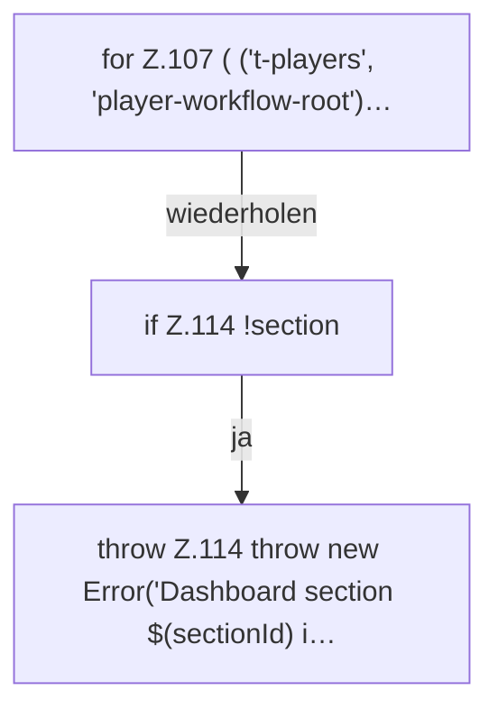

[[00 Start]] › [[Dashboard-UI]] › [[UI-App]] › [[App.readLegacyDashboard]] › [[App.readLegacyDashboard.Teil1.Z107]]

# App.readLegacyDashboard.Teil1.Z107



```knoten
for Z.107 ( ('t-players', 'player-workflow-root')…
  Zeile 107: Schleife `( ('t-players', 'player-workflow-root')…`.
if Z.114 !section
  Zeile 114: prüft `!section`.
throw Z.114 throw new Error('Dashboard section $(sectionId) i…
  Zeile 114: Abbruch `throw new Error('Dashboard section $(sectionId) i…`.
```

> [!knoten]- Was die Blöcke tun
> - **for Z.107 ( ('t-players', 'player-workflow-root')…**: Zeile 107: Schleife `( ('t-players', 'player-workflow-root')…`.
> - **if Z.114 !section**: Zeile 114: prüft `!section`.
> - **throw Z.114 throw new Error('Dashboard section $(sectionId) i…**: Zeile 114: Abbruch `throw new Error('Dashboard section $(sectionId) i…`.

- Der Ablauf geht in [[Glossar#Zeile|Zeile]] 107 weiter. Eine Ebene tiefer steht er genauer.
- Fortsetzung von `App.readLegacyDashboard.Teil1`.
