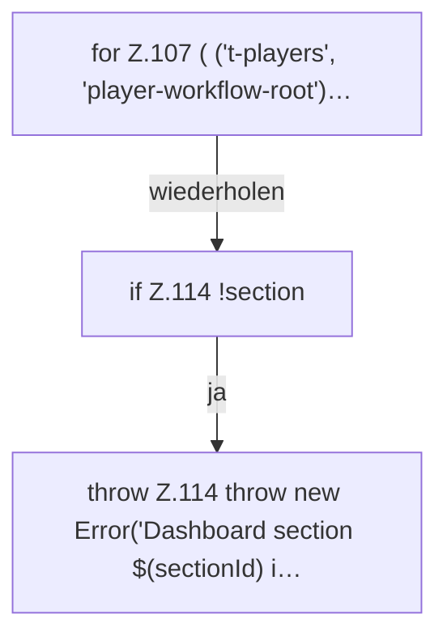

[[00 Start]] › [[Dashboard-UI]] › [[UI-App]] › [[App.readLegacyDashboard]] › [[App.readLegacyDashboard.Teil1.Z107]]

# App.readLegacyDashboard.Teil1.Z107

- Fortsetzung von `App.readLegacyDashboard.Teil1`, Quellreihenfolge.
