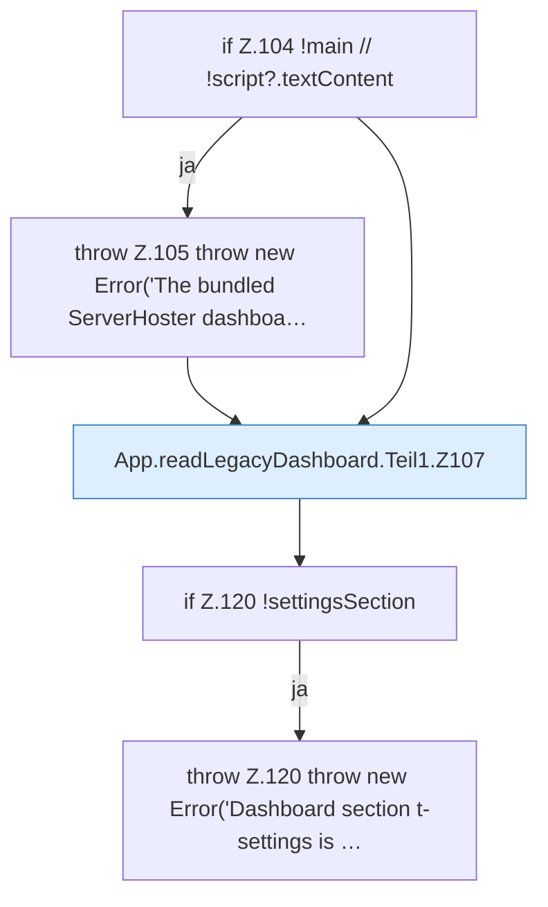

[[00 Start]] › [[Dashboard-UI]] › [[UI-App]] › [[App.readLegacyDashboard]] › [[App.readLegacyDashboard.Teil1]]

# App.readLegacyDashboard.Teil1



```knoten
if Z.104 !main // !script?.textContent
  Zeile 104: prüft `!main // !script?.textContent`.
throw Z.105 throw new Error('The bundled ServerHoster dashboa…
  Zeile 105: Abbruch `throw new Error('The bundled ServerHoster dashboa…`.
App.readLegacyDashboard.Teil1.Z107
  Fortsetzung des Ablaufs ab Zeile 107.
if Z.120 !settingsSection
  Zeile 120: prüft `!settingsSection`.
throw Z.120 throw new Error('Dashboard section t-settings is …
  Zeile 120: Abbruch `throw new Error('Dashboard section t-settings is …`.
```

- Fortsetzung von `App.readLegacyDashboard`, Quellreihenfolge.
