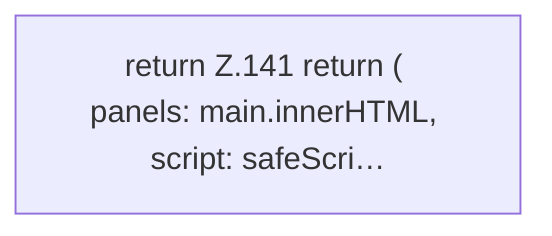

[[00 Start]] › [[Dashboard-UI]] › [[UI-App]] › [[App.readLegacyDashboard]] › [[App.readLegacyDashboard.Teil2]]

# App.readLegacyDashboard.Teil2



```knoten
return Z.141 return ( panels: main.innerHTML, script: safeScri…
  Zeile 141: Rückgabe `return ( panels: main.innerHTML, script: safeScri…`.
```

- Fortsetzung von `App.readLegacyDashboard`, Quellreihenfolge.
