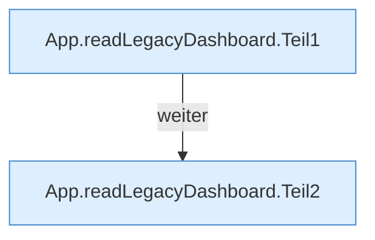

[[00 Start]] › [[Dashboard-UI]] › [[UI-App]] › [[App.readLegacyDashboard]]

# App.readLegacyDashboard

`App.readLegacyDashboard()` [ui/src/App.tsx:100–142](https://github.com/Sciddie/minecraft-serverhoster-plugin/blob/95b02b953b0b4c23673e900e021a7c3c844aa37d/ui/src/App.tsx#L100-L142)



```knoten
App.readLegacyDashboard.Teil1
  Abschnitt 1 dieses Ablaufs, in Quellreihenfolge.
App.readLegacyDashboard.Teil2
  Abschnitt 2 dieses Ablaufs, in Quellreihenfolge.
```

- Ersetzt Legacy-Abschnitte und löscht vier `load…`-Aufrufe aus dem Script.
- Befund: doppelte Implementierung, sicher. App.tsx:100–141 entfernt loadPlayers/loadSetup/loadBackup/loadTasks
