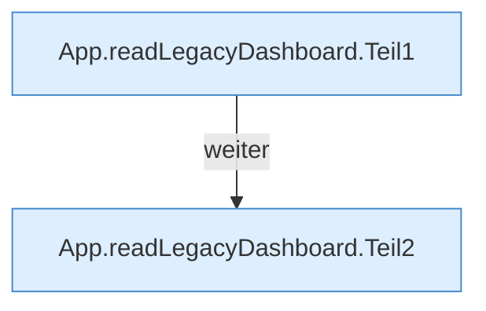

[[00 Start]] › [[Dashboard-UI]] › [[UI-App]] › [[App.readLegacyDashboard]]

# App.readLegacyDashboard

`App.readLegacyDashboard()` [ui/src/App.tsx:100–142](https://github.com/Sciddie/minecraft-serverhoster-plugin/blob/95b02b953b0b4c23673e900e021a7c3c844aa37d/ui/src/App.tsx#L100-L142)



```knoten
App.readLegacyDashboard.Teil1
  Ein weiterer Abschnitt derselben Übersicht. Im [[Glossar#Quelltext|Quelltext]] heißt das `Teil1`.
App.readLegacyDashboard.Teil2
  Ein weiterer Abschnitt derselben Übersicht. Im [[Glossar#Quelltext|Quelltext]] heißt das `Teil2`.
```

> [!knoten]- Was die Blöcke tun
> - **App.readLegacyDashboard.Teil1**: Ein weiterer Abschnitt derselben Übersicht. Im [[Glossar#Quelltext|Quelltext]] heißt das `Teil1`.
> - **App.readLegacyDashboard.Teil2**: Ein weiterer Abschnitt derselben Übersicht. Im [[Glossar#Quelltext|Quelltext]] heißt das `Teil2`.

- Liest die ältere [[Glossar#Bedienseite|Bedienseite]] und schneidet die Bereiche heraus, die die neuere Seite selbst übernimmt.
- Auffällig: derselbe Teil ist zweimal vorhanden. Das nennt man [[Glossar#Doppelt gebaut|Doppelt gebaut]].
