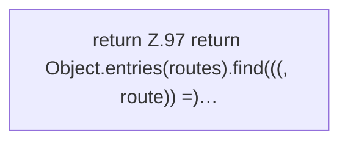

[[00 Start]] › [[Dashboard-UI]] › [[UI-App]] › [[App.tabFromPath]]

# App.tabFromPath

`App.tabFromPath(path: string)` [ui/src/App.tsx:96–98](https://github.com/Sciddie/minecraft-serverhoster-plugin/blob/95b02b953b0b4c23673e900e021a7c3c844aa37d/ui/src/App.tsx#L96-L98)



```knoten
return Z.97 return Object.entries(routes).find(((, route)) =)…
  Zeile 97: Rückgabe `return Object.entries(routes).find(((, route)) =)…`.
```

- `tabFromPath` in `ui/src/App.tsx`
