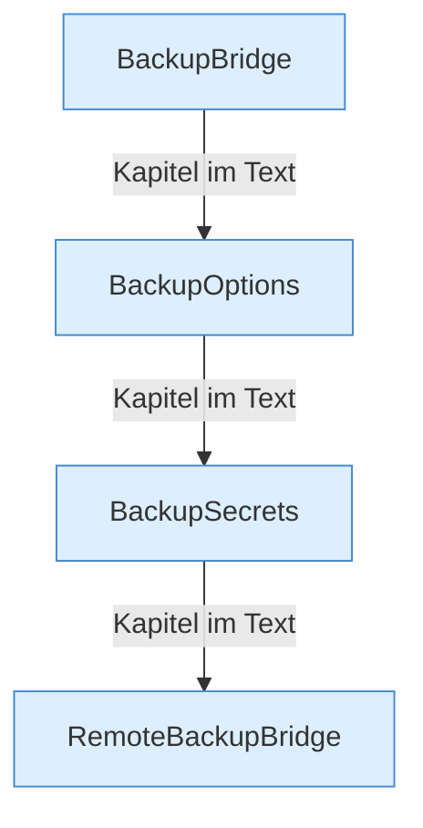

[[00 Start]] › [[Backup]] › [[Backup-Bruecken]]

# Backup-Bruecken



```knoten
BackupBridge
  Packt die [[Glossar#Sicherungskopie|Sicherungskopie]] auf diesem Rechner und kann sie wieder auspacken.
BackupOptions
  Die Angaben für einen einzelnen Sicherungslauf, zum Beispiel was mit hineinkommt.
BackupSecrets
  Die Zugangsdaten für die [[Glossar#Sicherungskopie|Sicherungskopie]] auf einem anderen Rechner.
RemoteBackupBridge
  Schickt die [[Glossar#Sicherungskopie|Sicherungskopie]] über das Netz auf einen anderen Rechner und holt sie von dort zurück.
```

> [!knoten] Was die Blöcke tun
> - **BackupBridge**: Packt die [[Glossar#Sicherungskopie|Sicherungskopie]] auf diesem Rechner und kann sie wieder auspacken.
> - **BackupOptions**: Die Angaben für einen einzelnen Sicherungslauf, zum Beispiel was mit hineinkommt.
> - **BackupSecrets**: Die Zugangsdaten für die [[Glossar#Sicherungskopie|Sicherungskopie]] auf einem anderen Rechner.
> - **RemoteBackupBridge**: Schickt die [[Glossar#Sicherungskopie|Sicherungskopie]] über das Netz auf einen anderen Rechner und holt sie von dort zurück.

- Die beiden Wege für die [[Glossar#Sicherungskopie|Sicherungskopie]]: auf diesem Rechner, oder über das Netz. Dazu Zugangsdaten und Optionen.
