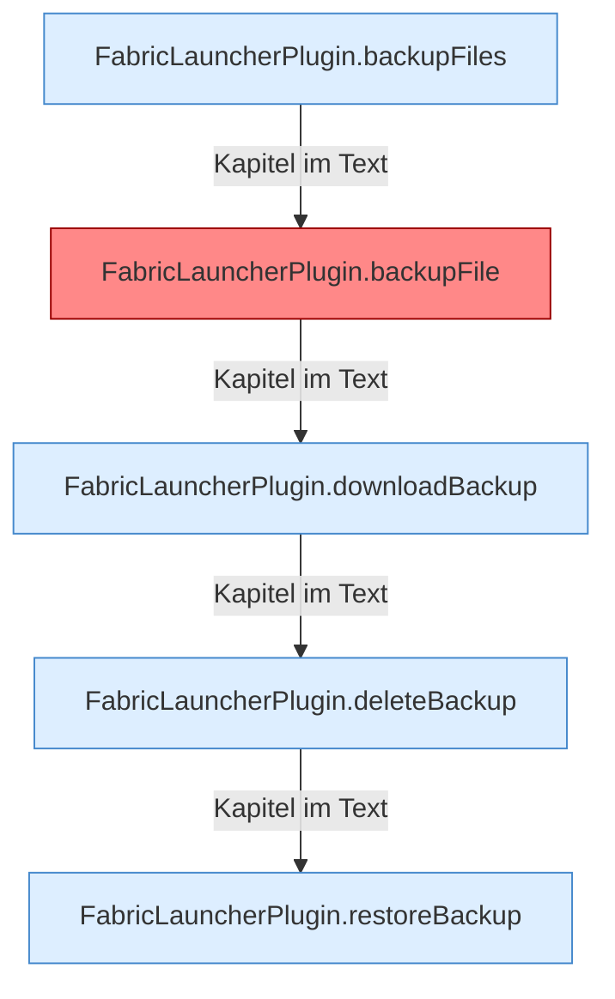

[[00 Start]] › [[Backup]] › [[Backup-Dateien]]

# Backup-Dateien



```knoten
FabricLauncherPlugin.backupFiles
  Das [[Glossar#Plugin|Plugin]] sichert die Dateien.
FabricLauncherPlugin.backupFile
  Das [[Glossar#Plugin|Plugin]] sichert die Datei. Auffällig: im normalen Betrieb ruft das niemand auf. Das nennt man [[Glossar#Ungenutzt|Ungenutzt]].
FabricLauncherPlugin.downloadBackup
  Das [[Glossar#Plugin|Plugin]] holt die [[Glossar#Sicherungskopie|Sicherungskopie]].
FabricLauncherPlugin.deleteBackup
  Das [[Glossar#Plugin|Plugin]] löscht die [[Glossar#Sicherungskopie|Sicherungskopie]].
FabricLauncherPlugin.restoreBackup
  Das [[Glossar#Plugin|Plugin]] stellt wieder her die [[Glossar#Sicherungskopie|Sicherungskopie]].
```

> [!knoten] Was die Blöcke tun
> - **FabricLauncherPlugin.backupFiles**: Das [[Glossar#Plugin|Plugin]] sichert die Dateien.
> - **FabricLauncherPlugin.backupFile**: Das [[Glossar#Plugin|Plugin]] sichert die Datei. Auffällig: im normalen Betrieb ruft das niemand auf. Das nennt man [[Glossar#Ungenutzt|Ungenutzt]].
> - **FabricLauncherPlugin.downloadBackup**: Das [[Glossar#Plugin|Plugin]] holt die [[Glossar#Sicherungskopie|Sicherungskopie]].
> - **FabricLauncherPlugin.deleteBackup**: Das [[Glossar#Plugin|Plugin]] löscht die [[Glossar#Sicherungskopie|Sicherungskopie]].
> - **FabricLauncherPlugin.restoreBackup**: Das [[Glossar#Plugin|Plugin]] stellt wieder her die [[Glossar#Sicherungskopie|Sicherungskopie]].

- Wie die [[Glossar#Sicherungskopie|Sicherungskopie]] heißt, wo sie liegt, und wie viele alte Kopien behalten werden.
