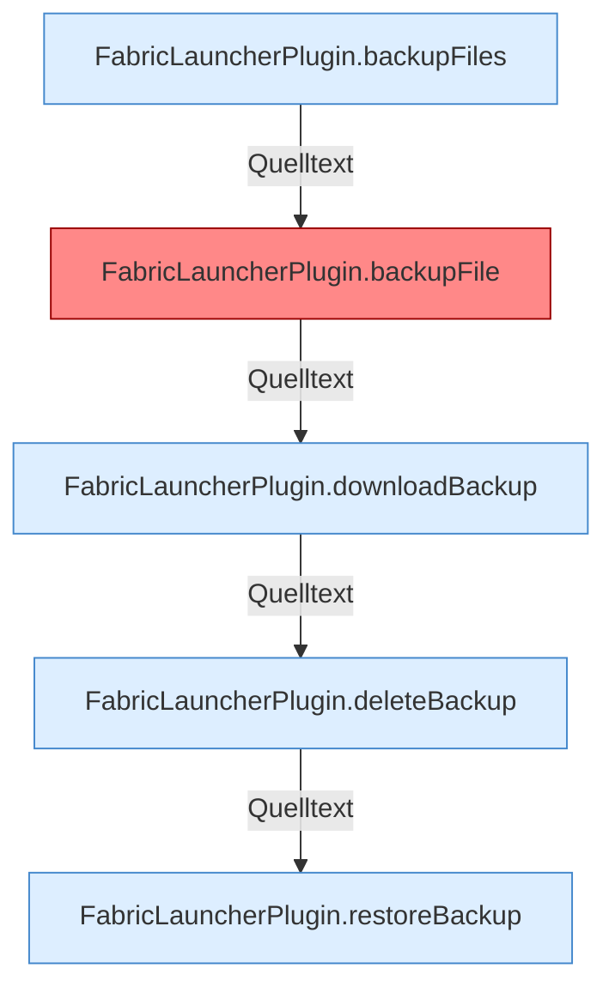

[[00 Start]] › [[Backup]] › [[Backup-Dateien]]

# Backup-Dateien



```knoten
FabricLauncherPlugin.backupFiles
  Sichert `backupFiles`. Ruft `remoteBackupSelected`, `backupCredentials`, `list`.
FabricLauncherPlugin.backupFile
  Sichert `backupFile`. Ruft `remoteBackupSelected`, `file`, `backupSpec`. Befund: toter Code (sicher).
FabricLauncherPlugin.downloadBackup
  Liefert zum Herunterladen `downloadBackup`. Ruft `remoteBackupSelected`, `backupCredentials`, `download`.
FabricLauncherPlugin.deleteBackup
  Löscht `deleteBackup`. Ruft `remoteBackupSelected`, `backupCredentials`, `delete`.
FabricLauncherPlugin.restoreBackup
  Stellt wieder her `restoreBackup`. Ruft `slot`, `running`, `remoteBackupSelected`.
```


