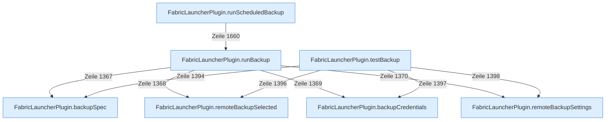

[[00 Start]] › [[Backup]] › [[Backup-Lauf]]

# Backup-Lauf



```knoten
FabricLauncherPlugin.runBackup
  Das [[Glossar#Plugin|Plugin]] führt aus die [[Glossar#Sicherungskopie|Sicherungskopie]].
FabricLauncherPlugin.testBackup
  Das [[Glossar#Plugin|Plugin]] prüft die [[Glossar#Sicherungskopie|Sicherungskopie]].
FabricLauncherPlugin.remoteBackupSelected
  Das [[Glossar#Plugin|Plugin]] sichert die Auswahl.
FabricLauncherPlugin.remoteBackupSettings
  Das [[Glossar#Plugin|Plugin]] sichert die [[Glossar#Einstellungen|Einstellungen]].
FabricLauncherPlugin.backupCredentials
  Das [[Glossar#Plugin|Plugin]] sichert die Zugangsdaten.
FabricLauncherPlugin.backupSpec
  Das [[Glossar#Plugin|Plugin]] sichert die Vorgabe.
FabricLauncherPlugin.runScheduledBackup
  Das [[Glossar#Plugin|Plugin]] führt aus zur geplanten Zeit die [[Glossar#Sicherungskopie|Sicherungskopie]].
```

> [!knoten] Was die Blöcke tun
> - **FabricLauncherPlugin.runBackup**: Das [[Glossar#Plugin|Plugin]] führt aus die [[Glossar#Sicherungskopie|Sicherungskopie]].
> - **FabricLauncherPlugin.testBackup**: Das [[Glossar#Plugin|Plugin]] prüft die [[Glossar#Sicherungskopie|Sicherungskopie]].
> - **FabricLauncherPlugin.remoteBackupSelected**: Das [[Glossar#Plugin|Plugin]] sichert die Auswahl.
> - **FabricLauncherPlugin.remoteBackupSettings**: Das [[Glossar#Plugin|Plugin]] sichert die [[Glossar#Einstellungen|Einstellungen]].
> - **FabricLauncherPlugin.backupCredentials**: Das [[Glossar#Plugin|Plugin]] sichert die Zugangsdaten.
> - **FabricLauncherPlugin.backupSpec**: Das [[Glossar#Plugin|Plugin]] sichert die Vorgabe.
> - **FabricLauncherPlugin.runScheduledBackup**: Das [[Glossar#Plugin|Plugin]] führt aus zur geplanten Zeit die [[Glossar#Sicherungskopie|Sicherungskopie]].

- Ein Durchlauf, der die [[Glossar#Sicherungskopie|Sicherungskopie]] packt und ablegt.
