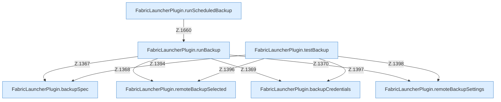

[[00 Start]] › [[Backup]] › [[Backup-Lauf]]

# Backup-Lauf



```knoten
FabricLauncherPlugin.runBackup
  Führt aus `runBackup`. Ruft `slot`, `running`, `send`.
FabricLauncherPlugin.testBackup
  Prüft `testBackup`. Ruft `backupSpec`, `remoteBackupSelected`, `backupCredentials`.
FabricLauncherPlugin.remoteBackupSelected
  `remoteBackupSelected` in `FabricLauncherPlugin.java`.
FabricLauncherPlugin.remoteBackupSettings
  `remoteBackupSettings` in `FabricLauncherPlugin.java`.
FabricLauncherPlugin.backupCredentials
  Sichert `backupCredentials`. Ruft `load`.
FabricLauncherPlugin.backupSpec
  Sichert `backupSpec`.
FabricLauncherPlugin.runScheduledBackup
  Führt aus `runScheduledBackup`. Ruft `slot`, `running`, `add`.
```


